# Monitor Resources with Google Cloud Observability

**Author:** Muhammed Abdulazeez  
**Contact:** `muhammedabdulazeez770@gmail.com`  
**Lab Project ID:** `qwiklabs-gcp-02-8b757eb619d7`  
**Completed:** November 27, 2026  

---

## Overview

In this hands-on Google Cloud lab, I configured end-to-end observability across a three-node NGINX Compute Engine fleet using **Google Cloud Monitoring**. Rather than treating monitoring as passive graphs, I structured the workflow around core Site Reliability Engineering (SRE) practices: visualizing real-time CPU utilization on a custom dashboard, reducing alert fatigue with a multi-condition alerting policy, organizing instances dynamically through resource groups, verifying external availability with global HTTP uptime checks, and cleanly decommissioning alert policies after validation.

This repository also includes an **interactive web companion** built with React, TypeScript, and Tailwind CSS so anyone reviewing this project on Vercel can explore every screenshot I captured, test the multi-condition alert thresholds, filter the dynamic resource group, and run simulated uptime checks directly in the browser.

---

## Objectives Completed

- Verified three pre-provisioned Compute Engine VM instances (`nginxstack-1`, `nginxstack-2`, `nginxstack-3`) running in `us-west1-a`.
- Built a custom dashboard (`My Dashboard`) and configured a line chart (`My Chart`) tracking `VM Instance - CPU utilization`, then cross-checked metrics in **Metrics Explorer**.
- Created a multi-condition alerting policy (`My Alert Policy`) combining `CPU usage` and `CPU utilization` thresholds above `20` over a `1 min` rolling window with `All conditions are met`, routed to my email notification channel (`Tester`).
- Organized the fleet into a dynamic resource group (`VM instances`) matching instances whose name contains `nginx`.
- Configured and tested an HTTP uptime check (`My Uptime check`) targeting the `VM instances` group on port `80` every `60s`, verifying a `200 (OK)` response in `3 ms`.
- Disabled the active alerting policies at lab teardown to follow clean post-lab hygiene.

---

## Infrastructure Inventory

| Instance Name | Zone | Machine Type | Internal IP | External IP | Baseline CPU Usage | Baseline CPU Utilization |
| :--- | :--- | :--- | :--- | :--- | :--- | :--- |
| `nginxstack-1` | `us-west1-a` | `e2-micro` | `10.138.0.4` | `136.66.120.74` | `0.005` – `0.009` | `1.962%` |
| `nginxstack-2` | `us-west1-a` | `e2-micro` | `10.138.0.2` | `136.86.196.149` | `0.005` | `2.174%` |
| `nginxstack-3` | `us-west1-a` | `e2-micro` | `10.138.0.3` | `35.247.56.3` | `0.021` – `0.030` | `12.032%` |

---

## Step-by-Step Walkthrough

### Task 1. Verify Compute Engine Resources

I started by navigating to **Compute Engine > VM instances** in the Google Cloud console to confirm that all three target NGINX nodes (`nginxstack-1`, `nginxstack-2`, and `nginxstack-3`) were running and reachable in `us-west1-a`.

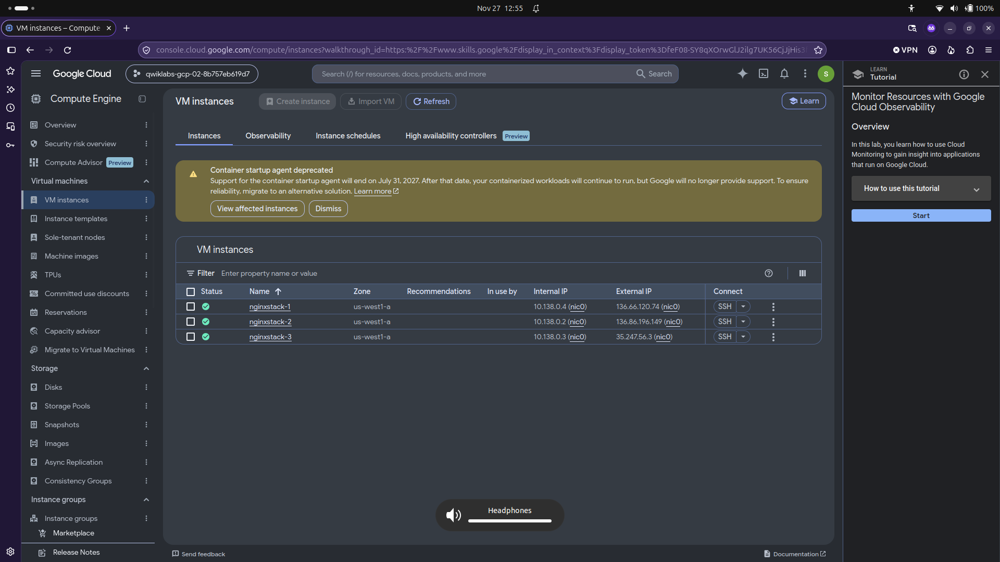

---

### Task 2. Create Custom Dashboards & Explore Metrics

Next, I opened **Observability > Monitoring > Dashboards** and created a new custom dashboard named **`My Dashboard`**.

1. Selected **Add widget > Line** and titled the widget **`My Chart`**.
2. Selected the **`VM Instance > Instance > CPU utilization`** metric (`compute.googleapis.com/instance/cpu/utilization`).
3. Inspected the time series across all three instances, then recreated the view inside **Metrics Explorer** to inspect ad-hoc metric behavior without persisting a widget.

> **SRE Takeaway:** Monitoring sits at the foundation of Site Reliability Engineering—applying software engineering principles to operations in order to build ultra-scalable, reliable systems.

| Dashboards Overview | Widget Configuration (`My Chart`) | Saved Dashboard |
| :---: | :---: | :---: |
| 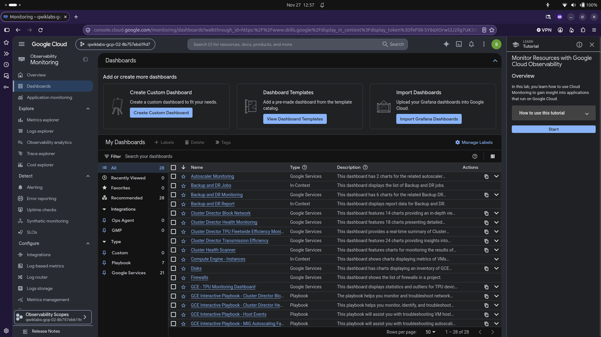 | 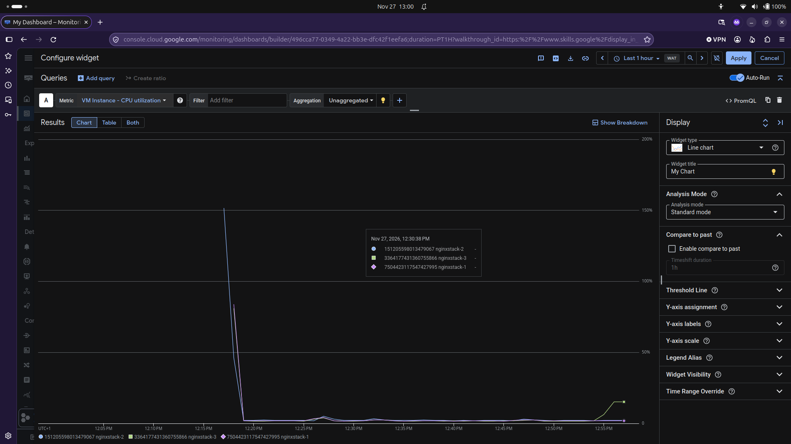 | 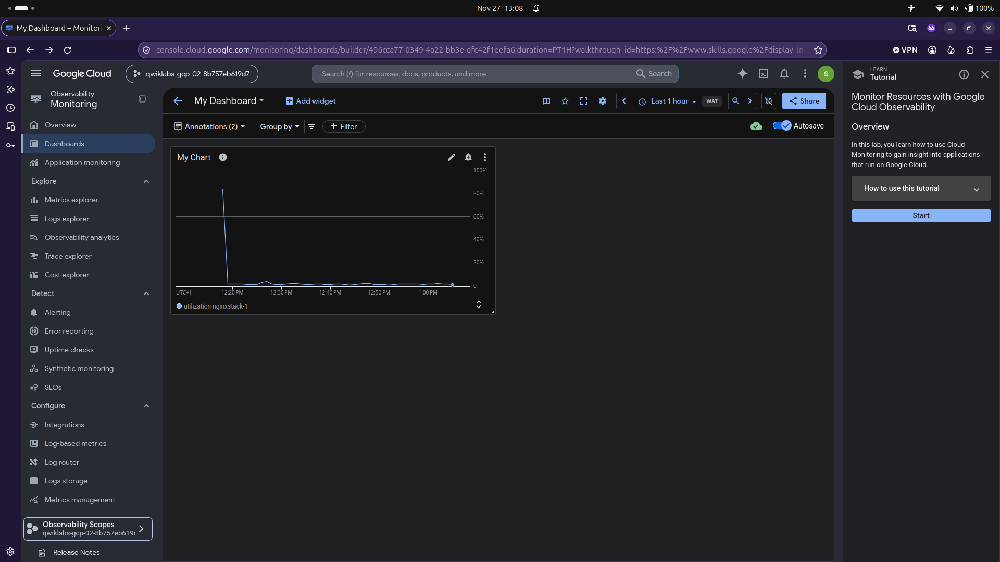 |

---

### Task 3. Create Multi-Condition Alerting Policies

To catch sustained CPU anomalies without flooding on-call channels with noisy single-metric spikes, I configured **`My Alert Policy`** under **Monitoring > Alerting**:

1. **Condition 1 — `VM Instance - CPU usage`:** Rolling window `1 min` (`mean`), Threshold `Above threshold` at `20`.
2. **Condition 2 — `VM Instance - CPU utilization`:** Rolling window `1 min` (`mean`), Threshold `Above threshold` at `20%`.
3. **Multi-condition trigger:** Set to **`All conditions are met`** (the same resource must violate both conditions).
4. **Notification Channel:** Created an Email channel (`Tester` -> `muhammedabdulazeez8011@gmail.com`) via **Manage Notification Channels**, refreshed the list, and attached it to the policy.

> **Alert Fatigue Strategy:** Configure alerts on user-facing **symptoms** rather than low-level causes, and customize notifications to what the receiving audience actually needs to act on.

| Condition 1: CPU Usage | Condition 2: CPU Utilization | Multi-Condition Trigger |
| :---: | :---: | :---: |
| 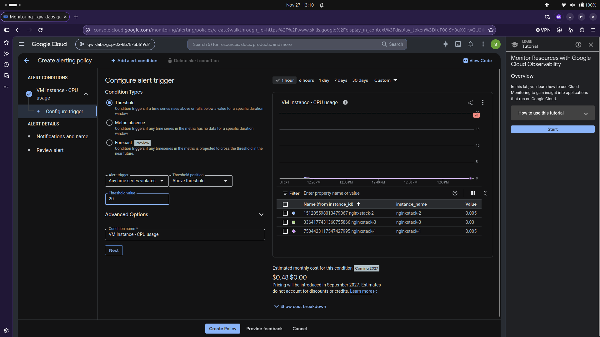 | 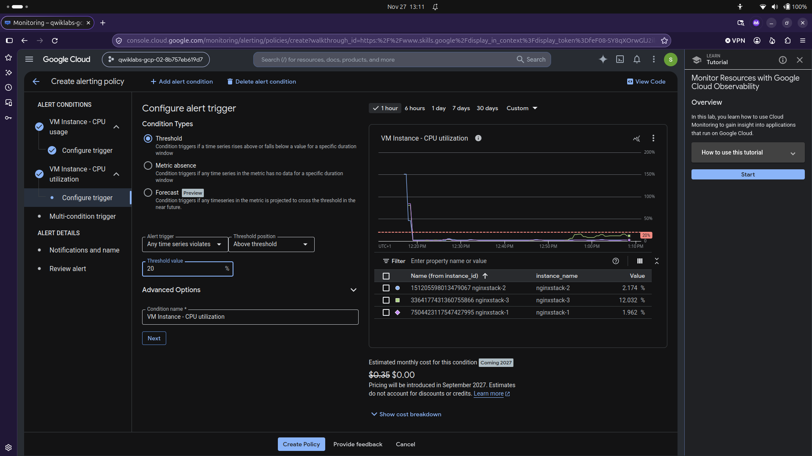 | 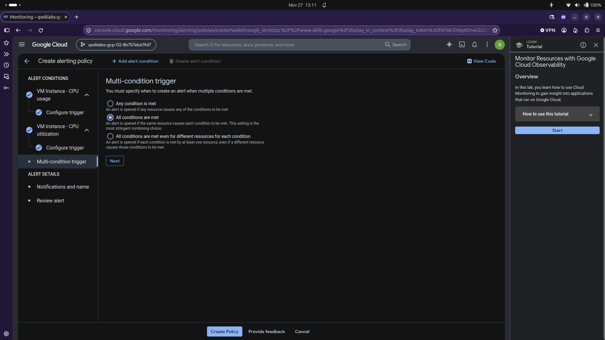 |

| Email Notification Channel (`Tester`) | Policy Review | Saved Policy Details |
| :---: | :---: | :---: |
| 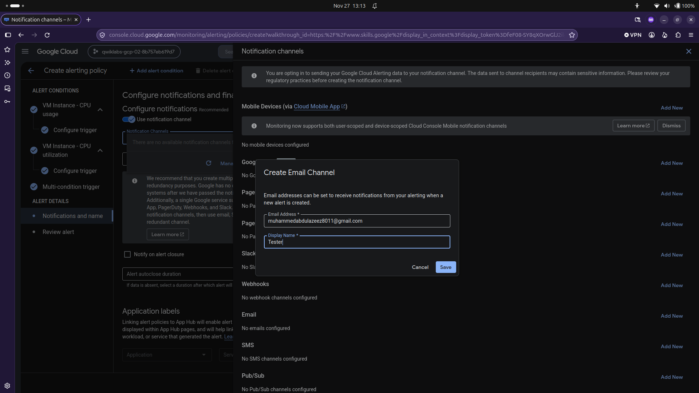 | 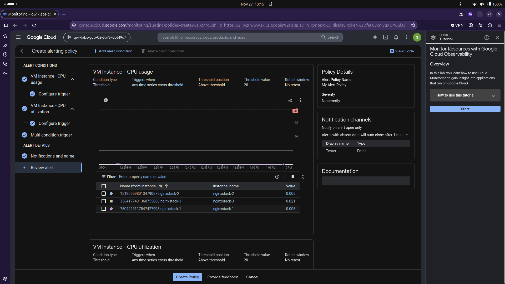 | 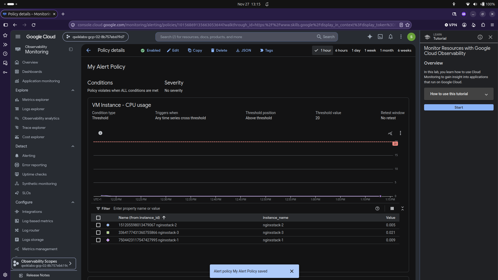 |

---

### Task 4. Create Resource Groups

To manage and monitor the NGINX instances as a single logical unit rather than tracking individual host IDs, I created a resource group under **Monitoring > Groups**:

- **Group Name:** `VM instances`
- **Criterion:** `Name` `Contains` `nginx`

Cloud Monitoring automatically grouped `nginxstack-1`, `nginxstack-2`, and `nginxstack-3` together along with their attached disks and built-in group metrics view.

| Create Resource Group | Group Dashboard Preview |
| :---: | :---: |
| 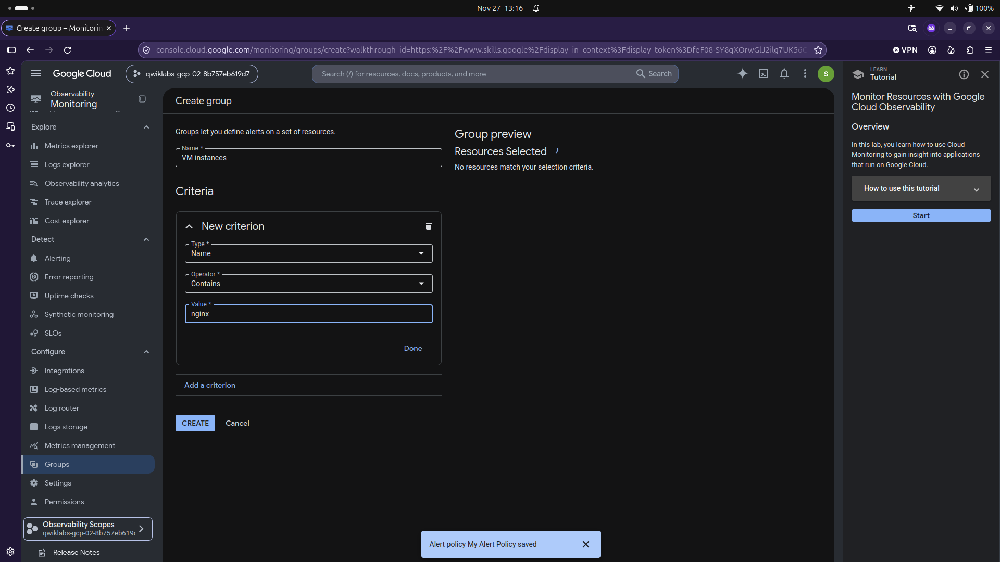 | 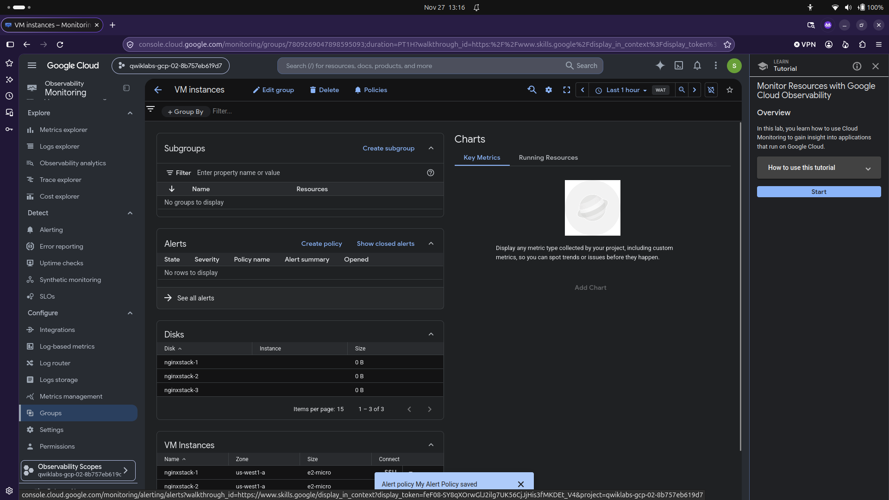 |

---

### Task 5. Create & Test an Uptime Check

With the `VM instances` group ready, I created an external availability probe under **Monitoring > Uptime checks**:

| Property | Configured Value |
| :--- | :--- |
| **Title** | `My Uptime check` |
| **Protocol** | `HTTP` |
| **Resource Type** | `Instance` |
| **Applies To** | `Group` -> `VM instances` |
| **Path / Port** | `/` on Port `80` |
| **Check Frequency** | `1 minute` (`60s`) |
| **Alert & Notification** | `Tester` (Email) |

Before clicking **Create**, I ran the **Test** action and verified `Responded with "200 (OK)" in 3 ms`. Valid notification targets for Cloud Monitoring uptime alerts include **Email**, **SMS**, **Pub/Sub**, **Webhooks**, and **3rd party services**.

| Notification Channel Attached | Connection Test (`200 OK in 3 ms`) | Uptime Check Details |
| :---: | :---: | :---: |
| 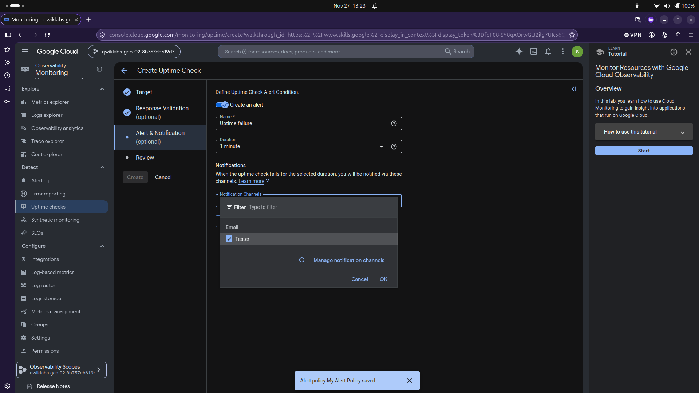 | 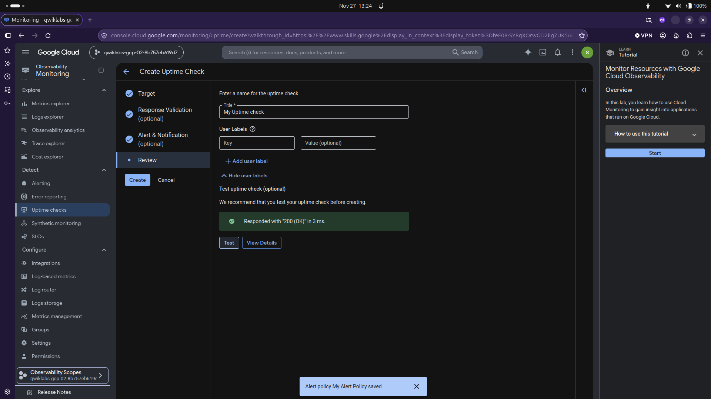 | 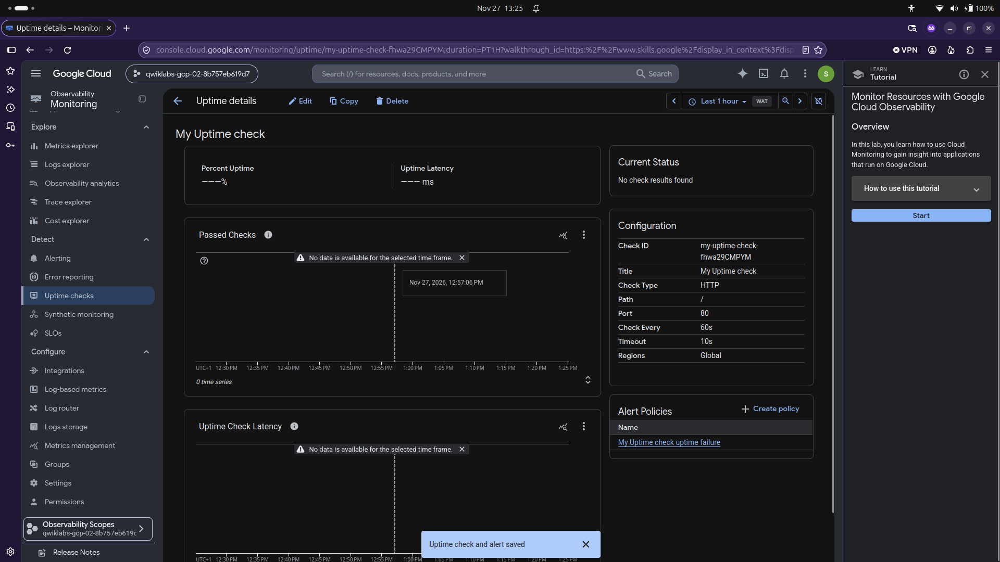 |

---

### Task 6. Disable Alerting Policies

Because Cloud Monitoring alerting policies remain active even after temporary lab environments wind down, I opened **Monitoring > Alerting > Policies** and toggled the alert policies off cleanly (`Policy disabled`).

| Active Policies | Policies Disabled |
| :---: | :---: |
| 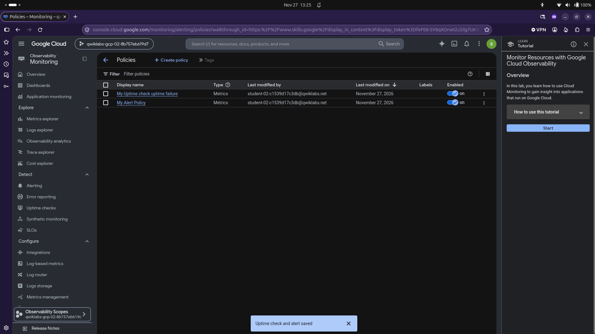 | 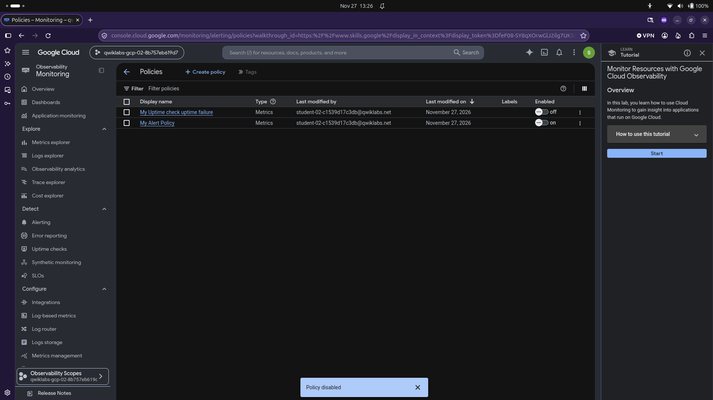 |

---

## Interactive Web App & Vercel Deployment

This repository ships with a Vite + React + TypeScript interactive lab companion that turns my walkthrough into a live sandbox.

### Run Locally

```bash
npm install
npm run dev
```

### Build for Production

```bash
npm run build
```

### Deploy to Vercel

1. Push this repository to GitHub.
2. Import the project in [Vercel](https://vercel.com/new) — `vercel.json` is already included with Vite framework settings and SPA rewrites.
3. Click **Deploy** (zero environment variables required).

---

*Documented and built by **Muhammed Abdulazeez**.*
